<p align="center">
  
</p>

<h1 align="center">mutaspec</h1>

<p align="center">
  <strong>Measure how good your tests are: plant bugs and see which ones your tests catch.</strong><br>
  Any language · any test command · unit, integration, API and UI tests · skills for coding agents
</p>

<p align="center">
  <a href="LICENSE"></a>
  <a href="docs/PLAN.md"></a>
  <a href="https://agentskills.io"></a>
</p>

<p align="center">
  <a href="#how-it-works">How it works</a> ·
  <a href="#status-and-roadmap">Status</a> ·
  <a href="#documentation">Documentation</a> ·
  <a href="#contributing">Contributing</a>
</p>

---

> **Status: design.** You cannot install mutaspec yet. This repository holds the plan, the decisions and the specifications. See [Status and roadmap](#status-and-roadmap).

## About

Code coverage shows which lines your tests run. It does not show if your tests find bugs.

mutaspec answers that question with a number. It plants bugs in a copy of your code and runs your **existing** tests against each bug. A test that fails has caught the bug. The result is a score for each test level and for all levels together:

```text
bugs caught / bugs injected
```

For each bug that your tests miss, an AI agent explains why. It suggests what to test and at which level. You change the tests. Then you run mutaspec again against the **same** bugs and see the score change.

mutaspec calls each planted bug a **Mutant**. The [glossary](GLOSSARY.md) defines all terms.

**mutaspec is for you if:**

- you want one number that tells you how well your tests find bugs
- your tests are not only unit tests, but also integration, API or UI tests
- you want concrete advice on which tests to add, not only a score

## How it works

```text
 baseline (HEAD) ──► run all suites ──► must pass (flaky tests are set aside)
        │
        ├─ + bug 1 (patch) ──► run suites ──► caught? ─┐
        ├─ + bug 2 (patch) ──► run suites ──► caught? ─┼─► score per level ─► suggestions ─► you improve tests
        └─ + bug N (patch) ──► run suites ──► caught? ─┘                                        │
                         ▲                                                                        │
                         └──────────────── next round, same bugs ◄────────────────────────────────┘
```

| Step | What happens |
|---|---|
| **Configure** | You give the source folders and one test command (a Suite) for each test level. |
| **Baseline** | mutaspec runs each Suite on the clean code more than one time. All tests must pass. Flaky or failing tests are set aside and reported. |
| **Inject** | mutaspec makes the Mutant Set one time. Each Mutant is a git patch that changes source files only. |
| **Run** | For each Mutant, mutaspec applies the patch in a separate git worktree and runs the Suites. The cheapest Suite runs first. |
| **Score** | Each Mutant is Killed or Survived. mutaspec gives the Mutation Score for each level and for all levels. |
| **Suggest** | An AI agent reads each Survived Mutant. It tells you what is not tested and at which level to test it, and it gives a sketch of the check. |
| **Improve** | You write the tests. mutaspec does not write tests for you. |
| **Next round** | mutaspec runs the same Mutant Set against your new tests and shows what changed. |

## Key ideas

- **Your tests, any language.** A Suite is a shell command. Any test tool works. API and UI tests count too.
- **Your working tree stays safe.** mutaspec runs everything in git worktrees under `.mutaspec/worktrees/`. It never changes your files ([ADR 0001](docs/adr/0001-mutants-are-patches-run-in-worktrees.md)).
- **Two kinds of Mutants.** Rule Mutants come from simple changes, for example `<` to `<=` or `&&` to `||`. Agent Mutants are realistic bugs that a coding agent writes from the code and its specification.
- **The same Mutants in each round.** mutaspec saves the Mutant Set and uses it again. A change in the score comes from a change in the tests, not from different bugs.
- **People write the tests.** The agent only suggests ([ADR 0002](docs/adr/0002-agent-suggests-tests-user-writes-them.md)). Only a person can mark a Mutant as Equivalent.
- **Fair scores.** A failure of a flaky test, or of a test that failed before, does not count as a kill.
- **Works with any agent.** The core is a command-line tool and files. Skills and plugins for Claude Code and other coding agents only hold instructions.

## Status and roadmap

mutaspec is in the design stage. Each feature goes through an intent, a specification and a plan before anyone writes code ([process](docs/process.md)).

| Milestone | Result |
|---|---|
| **v0.1 walking skeleton** | A real score for the unit and API Suites of an example Spring Boot project. |
| **v0.2 the improvement loop** | Agent Mutants, suggestions, rounds, comparison, and a Claude Code skill and plugin. |
| **v0.3 scale and teams** | Runs on the changed code only, a CI gate, a self-evaluation benchmark and more languages. |

Java and Spring Boot come first. Python and TypeScript follow. The full plan and its risks are in [docs/PLAN.md](docs/PLAN.md).

## Documentation

| Document | Content |
|---|---|
| [Plan](docs/PLAN.md) | Goal, users, workflow, architecture, roadmap and risks |
| [Process](docs/process.md) | How each feature goes from intent to code |
| [Research](docs/research.md) | Existing tools and what mutaspec learns from them |
| [Decisions](docs/adr/) | Architecture decision records |
| [Intents](intent/) | One folder for each planned feature |
| [Glossary](GLOSSARY.md) | The terms that mutaspec uses |

## Contributing

Contributions are welcome, also in the design stage. Comments on the plan and the specifications are useful now.

1. Read the [process](docs/process.md) and the [glossary](GLOSSARY.md).
2. For a new idea or a problem, [open an issue](https://github.com/quark-sri/mutaspec/issues).
3. Each feature starts as an intent in `intent/NNNN-name/`. Do not write code for a feature before its specification is approved.
4. Use the terms of the glossary in code, documents and commit messages.

Instructions for AI coding agents are in [AGENTS.md](AGENTS.md).

## Security

If you find a security problem, do not open a public issue. Report it privately to the maintainers through [GitHub security advisories](https://github.com/quark-sri/mutaspec/security/advisories/new).

## License

mutaspec is licensed under the [Apache License 2.0](LICENSE).
